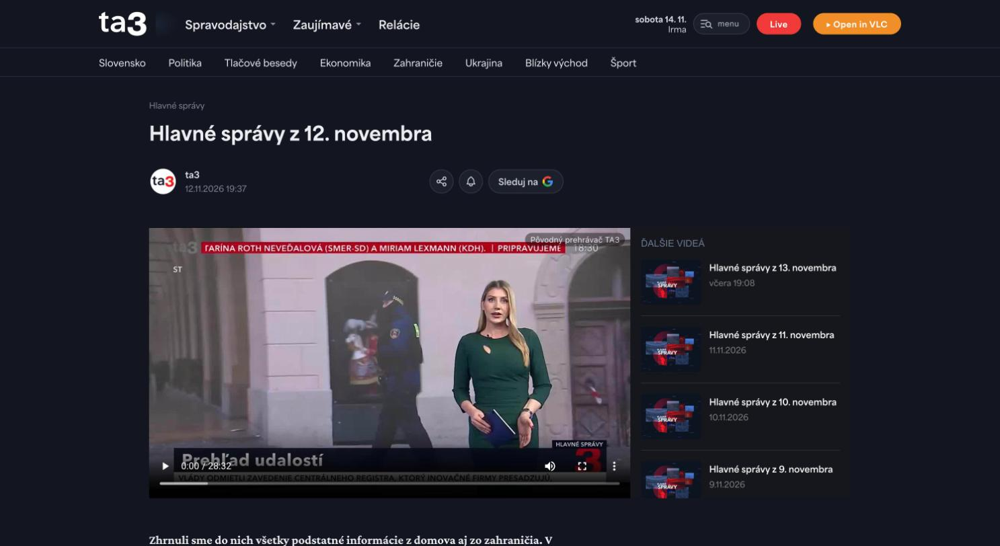

# TA3 bez reklám

Nástroje na pozeranie a sťahovanie relácií TA3 a ďalších slovenských archívov.

## 🧡 Rozšírenie pre Chrome: TA3 bez reklám – Open in VLC

Vlastný prehrávač pre archív TA3, bez reklám, a oranžové tlačidlo **▶ Open in VLC** vedľa tlačidla *Live*
(otvorí reláciu vo VLC). Funguje aj vtedy, keď sa pôvodné video na stránke len točí.
Rovnako nahrádza prehrávač na **JOJ play** (`play.joj.sk/player/...`). Titulky nie sú podporované a ani sa neplánujú.

➡️ **[Návod na inštaláciu a použitie](ta3-vlc-extension/README.md)** (priečinok [`ta3-vlc-extension/`](ta3-vlc-extension))

Stručne: spustite `./install.sh` v priečinku `ta3-vlc-extension`, potom v `chrome://extensions` zapnite režim pre
vývojárov a načítajte priečinok `ta3-vlc-extension/extension`. Celý postup krok za krokom je v návode vyššie.

## Ďalšie časti projektu

| Priečinok | Čo to je |
|---|---|
| [`ta3-vlc-extension/`](ta3-vlc-extension) | Rozšírenie pre Chrome (opísané vyššie) |
| [`ta3-cli/`](ta3-cli) | Nástroj pre príkazový riadok na sťahovanie zvuku z archívov (pozri [README](ta3-cli/README.md)) |
| [`ta3-android/`](ta3-android) | Android aplikácia na sťahovanie a prehrávanie relácií |
| [`samsung-tv/`](samsung-tv) | Súbory pre televízor Samsung |

## Licencia

Kód v tomto repozitári je pod licenciou [MIT](LICENSE). Knižnice v `ta3-vlc-extension/extension/vendor/`
([hls.js](ta3-vlc-extension/extension/vendor/hls.LICENSE), Apache-2.0, a
[dash.js](ta3-vlc-extension/extension/vendor/dash.LICENSE), BSD-3-Clause) a submoduly (napr. v `samsung-tv/`)
si zachovávajú svoje vlastné licencie.

Nie sme spojení s TA3 ani s TV JOJ. Videá a ich obsah patria ich vysielateľom, rozšírenie iba mení spôsob,
akým sa už verejne dostupný prúd prehráva vo vašom prehliadači.

## Kľúčové slová

TA3 bez reklám, TA3 archív, Hlavné správy, JOJ play, Bez servítky, stiahnuť TA3, TA3 VLC, rozšírenie Chrome.
