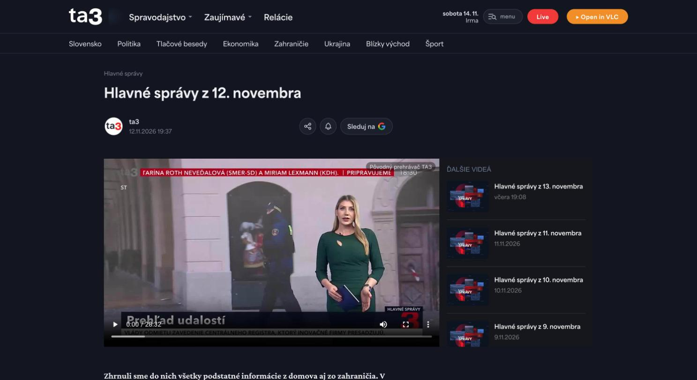
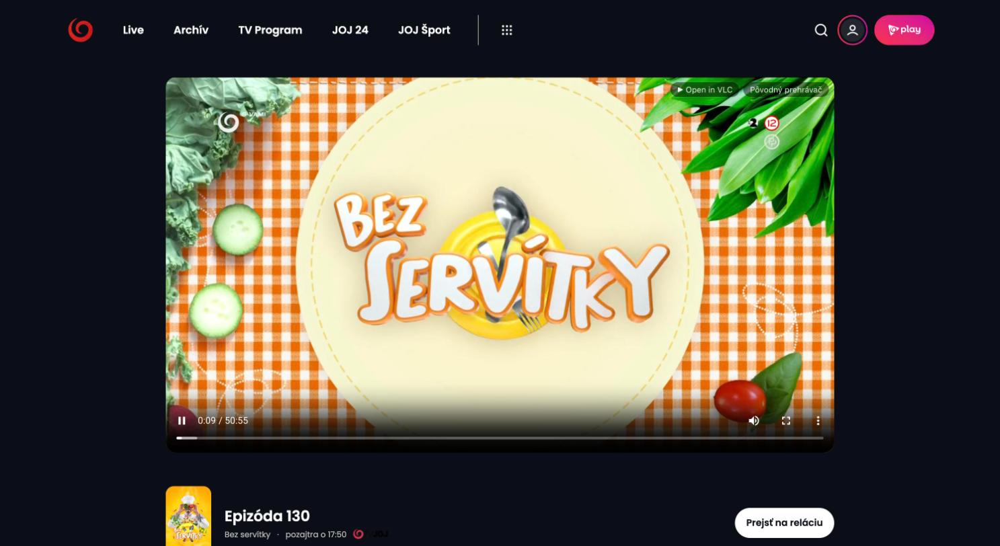

# TA3 bez reklám – Open in VLC (rozšírenie pre Chrome)

**TA3 bez reklám**: pozerajte relácie a archív TA3 a JOJ bez reklám a bez zaseknutého prehrávača.

Rozšírenie robí na stránkach s videom dve veci:

1. **Vlastný prehrávač.** Nahradí prehrávač TA3 alebo JOJ jednoduchým prehrávačom, ktorý spustí video hneď,
   bez reklám. Ak by niečo zlyhalo, vráti sa pôvodný prehrávač, a kedykoľvek naň môžete prepnúť odkazom
   **Pôvodný prehrávač** v rohu videa.
2. **Tlačidlo ▶ Open in VLC.** Jedným kliknutím sa relácia otvorí vo VLC.


*TA3: vlastný prehrávač a oranžové tlačidlo **▶ Open in VLC** vedľa *Live*.*


*JOJ: tlačidlá **▶ Open in VLC** a **Pôvodný prehrávač** sa zobrazia v rohu videa pri prejdení myšou.*

Podporené sú archívne videá na **TA3** (`ta3.com/relacie/...`) a **JOJ** (epizódy na `www.joj.sk` a na
`play.joj.sk`). Platený obsah sa nedá prehrať, rozšírenie ho neodomyká.

Čo zatiaľ nefunguje: priame prenosy (Live) a výber kvality. **Titulky nie sú podporované a ani sa neplánujú.**

Kľúčové slová: TA3 bez reklám, TA3 archív, Hlavné správy, JOJ play, Bez servítky, stiahnuť TA3, TA3 VLC, rozšírenie Chrome.

## Požiadavky

- macOS (tlačidlo Open in VLC; vlastný prehrávač funguje aj inde)
- Google Chrome
- [VLC](https://www.videolan.org/) nainštalovaný v `/Applications`

## Inštalácia

Ak chcete iba vlastný prehrávač, stačí **krok 0 a krok 2**. Krok 1 je potrebný len pre tlačidlo **Open in VLC**.

### Krok 0: Stiahnite projekt

Rozšírenie sa nenačítava z Chrome Web Store, ale priamo z priečinka, preto si ho najprv stiahnite. Buď cez Git:

```sh
git clone https://github.com/peterculak/ta3-bez-reklam.git
cd ta3-bez-reklam
```

alebo na stránke repozitára kliknite na zelené tlačidlo **Code → Download ZIP** a ZIP rozbaľte.
Priečinok potom nepresúvajte ani nemažte.

### Krok 1: Povoľte tlačidlo Open in VLC (stačí raz)

Chrome sám nevie spúšťať programy, preto treba raz spustiť v termináli:

```sh
cd ta3-vlc-extension
./install.sh
```

Ak sa zobrazí `Host registered.`, je hotovo.

### Krok 2: Nahrajte rozšírenie do Chrome

1. Otvorte v Chrome adresu `chrome://extensions`.
2. Vpravo hore zapnite **Režim pre vývojárov** (*Developer mode*).
3. Kliknite na **Načítať rozbalené** (*Load unpacked*) a vyberte priečinok `ta3-vlc-extension/extension`.
4. Skontrolujte, že je rozšírenie **zapnuté**.

### Krok 3: Vyskúšajte

1. Otvorte ľubovoľnú reláciu na TA3 alebo JOJ, napríklad
   `https://www.ta3.com/relacie/hlavne-spravy/relacia/1082413/hlavne-spravy-z-12-novembra`.
2. Ak bola stránka otvorená už predtým, obnovte ju (F5).
3. Video sa prehrá v novom prehrávači (po kliknutí na play), bez reklám.
4. Na TA3 je oranžové tlačidlo **▶ Open in VLC** v hlavičke vedľa *Live*, na JOJ sa zobrazí v rohu videa
   po prejdení myšou. Kliknutím sa relácia otvorí vo VLC.

## Aktualizácia

Po stiahnutí novej verzie kliknite na `chrome://extensions` na ikonu obnovenia na karte rozšírenia a obnovte
stránku s videom.

## Riešenie problémov

| Problém | Riešenie |
|---|---|
| Na stránke nie je tlačidlo ani nový prehrávač | Obnovte stránku a skontrolujte, či je rozšírenie zapnuté a stránka obsahuje video |
| Hlásenie `Specified native messaging host not found` | Spustite znova `./install.sh` a reštartujte Chrome |
| Hlásenie `Access to the specified native messaging host is forbidden` | Nahrajte rozšírenie znova z priečinka `ta3-vlc-extension/extension` |
| Hlásenie `Native host has exited` | Spustite znova `./install.sh` (presunuli ste priečinok?) a skontrolujte, či je VLC v `/Applications` |
| VLC sa otvorí, ale zobrazí chybu | Skúste to znova, adresa videa mohla vypršať |
| Zostal pôvodný prehrávač | Stránka sa mohla zmeniť. Obnovte ju, alebo použite pôvodný prehrávač |

## Odinštalovanie

```sh
rm "$HOME/Library/Application Support/Google/Chrome/NativeMessagingHosts/sk.ta3.vlc.json"
```

Potom odstráňte rozšírenie na `chrome://extensions`.
